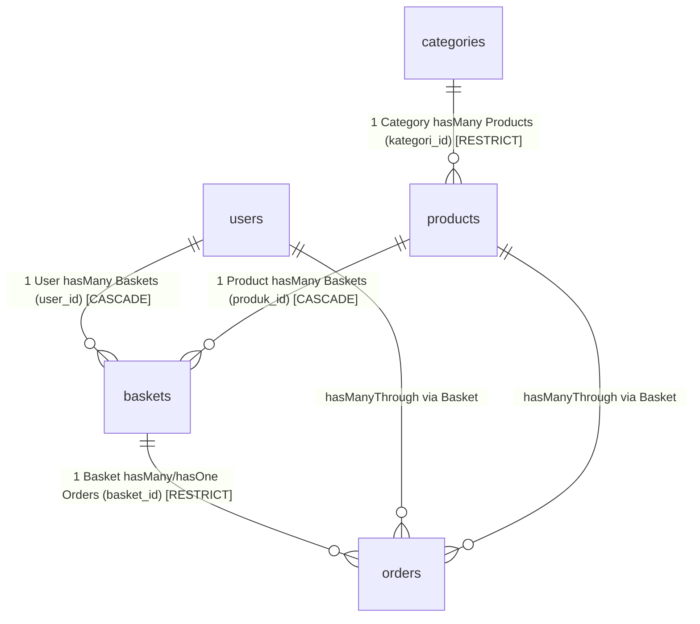

# LAPORAN ANALISIS MENYELURUH & AUDIT KONSISTENSI DATABASE CABILRENT
**Project:** CabilRent — Sistem Informasi Persewaan Kebaya, Heels, dan Kamisol  
**Framework:** Laravel 12.69.2 (PHP 8.3.32)  
**Database Server:** MySQL / MariaDB (Host: 127.0.0.1, Port: 3316, Database: `cabil_rent`)  
**Sifat Tugas:** **STRICTLY READ-ONLY (Tidak Ada Perubahan Kode, Database, SQL, Maupun Excel)**  
**Tanggal Audit:** 23 November 2026  

---

## DAFTAR ISI
1. [Daftar File Excel dan SQL yang Ditemukan](#1-daftar-file-excel-dan-sql-yang-ditemukan)
2. [Daftar Sheet Excel yang Diperiksa](#2-daftar-sheet-excel-yang-diperiksa)
3. [Daftar Tabel SQL](#3-daftar-tabel-sql)
4. [Daftar Tabel MySQL Aktual](#4-daftar-tabel-mysql-aktual)
5. [Hasil Perbandingan Seluruh Struktur (Matriks Perbandingan)](#5-hasil-perbandingan-seluruh-struktur-matriks-perbandingan)
6. [Hasil Audit Migration Laravel](#6-hasil-audit-migration-laravel)
7. [Hasil Audit Model Laravel](#7-hasil-audit-model-laravel)
8. [Hasil Audit Controller dan Query Database](#8-hasil-audit-controller-dan-query-database)
9. [Hasil Audit Relasi Antartabel](#9-hasil-audit-relasi-antartabel)
10. [Hasil Penelusuran Alur Fitur Aplikasi](#10-hasil-penelusuran-alur-fitur-aplikasi)
11. [Daftar Seluruh Ketidaksesuaian (Discrepancies)](#11-daftar-seluruh-ketidaksesuaian-discrepancies)
12. [Analisis Risiko terhadap Aplikasi](#12-analisis-risiko-terhadap-aplikasi)
13. [Bagian yang Sudah Sesuai (Matched)](#13-bagian-yang-sudah-sesuai-matched)
14. [Bagian yang Belum Dapat Diverifikasi (Needs Manual Test)](#14-bagian-yang-belum-dapat-diverifikasi-needs-manual-test)
15. [Rekomendasi Perbaikan Teknis (Tanpa Eksekusi)](#15-rekomendasi-perbaikan-teknis-tanpa-eksekusi)

---

## 1. DAFTAR FILE EXCEL DAN SQL YANG DITEMUKAN

Berdasarkan inventarisasi file di direktori `C:\Users\acer\Downloads` dan direktori project `C:\Users\acer\Kelompok4_CabilRent`, ditemukan berkas-berkas berikut beserta identifikasi versinya:

### A. Berkas Desain Database Excel (`.xlsx`)
| No | Nama File | Ukuran | Tanggal & Waktu Modifikasi | Lokasi Direktori | Identifikasi Versi & Karakteristik |
|---|---|---|---|---|---|
| 1 | `Tabel_Database_CabilRent_FIXXXXXXXBANGETTTT.xlsx` | 7.730 byte | 22/11/2026 11:05:04 | `C:\Users\acer\Downloads` | **Rancangan Acuan Utama (Diminta User)**. Memuat 5 tabel utama (`users`, `categories`, `products`, `baskets`, `orders`), aturan referensi FK (CASCADE/RESTRICT), dan tabel ringkasan migrasi tambahan (`google_id`, `avatar`, `status`, `slug`, `deskripsi`, `ukuran`, `stok`). |
| 2 | `Tabel_Database_CabilRent_FIXXXXXXXBANGETTTT_Lengkap.xlsx` | 7.739 byte | 22/11/2026 10:49:41 | `C:\Users\acer\Downloads` | Varian pra-final dari file nomor 1. Kolom panjang karakter PK dan FK diisi eksplisit angka `11`. Struktur kolom identik dengan nomor 1. |
| 3 | `Dokumentasi_Database_CabilRent_Revisi.xlsx` | 8.647 byte | 22/11/2026 10:15:34 | `C:\Users\acer\Downloads` | Versi dokumentasi intermediate. Menambahkan kolom catatan audit QA & validasi (stok >= 0, jumlah >= 1, FK review). |
| 4 | `Tabel_Database_CabilRent_FIXXXXXXX.xlsx` | 6.656 byte | 03/10/2026 18:52:16 | `C:\Users\acer\Downloads` | **Versi Paling Awal (Legacy)**. Belum memuat kolom `google_id`, `avatar`, `status`, `slug` kategori/produk, `deskripsi` kategori, `ukuran`, dan `stok`. |

### B. Berkas Database SQL (`.sql`)
| No | Nama File | Ukuran | Tanggal & Waktu Modifikasi | Lokasi Direktori | Identifikasi Versi & Karakteristik |
|---|---|---|---|---|---|
| 1 | `cabil_rent (8).sql` | 16.585 byte | 23/11/2026 18:58:41 | `C:\Users\acer\Downloads` | **Versi SQL Paling Mutakhir (Diminta User)**. Dump phpMyAdmin terbaru; telah menyertakan tabel `migrations` (10 baris) dan kolom `kode_pesanan` pada tabel `orders` beserta indeksnya. |
| 2 | `cabil_rent (7).sql` | 14.978 byte | 22/11/2026 11:06:16 | `C:\Users\acer\Downloads` | Versi batch migrasi constraints (belum ada kolom `kode_pesanan`). |
| 3 | `cabil_rent (6).sql` | 14.978 byte | 22/11/2026 10:49:51 | `C:\Users\acer\Downloads` | Identik dengan versi 7. |
| 4 | `cabil_rent (5).sql` | 14.949 byte | 22/11/2026 10:21:04 | `C:\Users\acer\Downloads` | Versi intermediate sebelum penyelarasan index unik slug. |
| 5 | `cabil_rent (4).sql` | 15.337 byte | 22/11/2026 09:57:56 | `C:\Users\acer\Downloads` | Versi intermediate dengan data pesanan awal. |
| 6 | `cabil_rent (3).sql` | 14.662 byte | 21/11/2026 20:38:59 | `C:\Users\acer\Downloads` | Penambahan status user, deskripsi kategori, dan stok produk. |
| 7 | `cabil_rent (2).sql` | 13.584 byte | 21/11/2026 20:33:28 | `C:\Users\acer\Downloads` | Penambahan google_id dan slug awal. |
| 8 | `cabil_rent.sql` | 7.800 byte | 03/10/2026 19:32:03 | `C:\Users\acer\Downloads` | Versi awal baseline bulan Oktober 2026. |
| 9 | `cabil_rent (1).sql` | 7.382 byte | 03/10/2026 18:52:01 | `C:\Users\acer\Downloads` | Versi awal baseline bulan Oktober 2026. |
| 10 | `cabil_rent_backup.sql` | 30.460 byte | 22/11/2026 18:14:26 | `C:\Users\acer\Kelompok4_CabilRent` | Cadangan data lokal sebelum audit sebelumnya. |

> [!NOTE]
> Sesuai instruksi pengguna, file **`Tabel_Database_CabilRent_FIXXXXXXXBANGETTTT.xlsx`** dan **`cabil_rent (8).sql`** dijadikan pembanding utama tanpa mengabaikan catatan evolusi dari versi lainnya.

---

## 2. DAFTAR SHEET EXCEL YANG DIPERIKSA

Pemeriksaan dilakukan dengan membaca seluruh berkas menggunakan script engine `openpyxl`:
- **Nama Sheet:** `Sheet1`
- **Total Baris Berisi Data:** 34 baris data terstruktur.
- **Tata Letak (Layout) Data:**
  - Baris 0–13, Kolom A–D: Definisi `Table Users` (12 atribut kolom).
  - Baris 0–7, Kolom F–I: Definisi `Table Categories` (6 atribut kolom).
  - Baris 0–14, Kolom K–N: Definisi `Table Products` (12 atribut kolom).
  - Baris 15–23, Kolom A–D: Definisi `Table Baskets` (7 atribut kolom).
  - Baris 9–21, Kolom F–I: Definisi `Table Orders` (10 atribut kolom).
  - Baris 24–28, Kolom A–C: Definisi Relasi & Aksi Referensi Foreign Key (`ON DELETE CASCADE` / `ON DELETE RESTRICT`).
  - Baris 24–33, Kolom F–I: Matriks Migrasi Tambahan (Google OAuth, SEO Slug, Stok Produk, Deskripsi Kategori, Ukuran Produk).

---

## 3. DAFTAR TABEL SQL

Pada file dump **`cabil_rent (8).sql`**, ditemukan **6 tabel** dengan rincian:
1. `baskets` (7 kolom, 2 Foreign Keys, 2 Indexes, 1 Primary Key, 14 baris data INSERT).
2. `categories` (6 kolom, 1 Unique Key, 1 Primary Key, 3 baris data INSERT).
3. `migrations` (3 kolom, 1 Primary Key, 10 baris data INSERT log migrasi Laravel).
4. `orders` (11 kolom, 1 Foreign Key, 2 Indexes, 1 Primary Key, 5 baris data INSERT).
5. `products` (12 kolom, 1 Foreign Key, 1 Unique Key, 1 Index, 1 Primary Key, 16 baris data INSERT).
6. `users` (11 kolom, 4 Unique Keys, 1 Primary Key, 7 baris data INSERT).

---

## 4. DAFTAR TABEL MYSQL AKTUAL

Koneksi read-only dieksekusi langsung terhadap server database aktif melalui konfigurasi Laravel (`cabil_rent` pada `127.0.0.1:3316` via `information_schema`):
- **Nama Database:** `cabil_rent`
- **Engine Penyimpanan:** `InnoDB`
- **Collation Tabel:** `utf8mb4_unicode_ci`

| Nama Tabel | Total Kolom | Jumlah Baris Riil | Status Auto Increment | Status Pemeriksaan |
|---|---|---|---|---|
| `baskets` | 7 kolom | 14 baris | Next AI: 15 | Aktif (Read-Only OK) |
| `categories` | 6 kolom | 3 baris | Next AI: 5 | Aktif (Read-Only OK) |
| `migrations` | 3 kolom | 10 baris | Next AI: 11 | Aktif (Read-Only OK) |
| `orders` | 11 kolom | 5 baris | Next AI: 6 | Aktif (Read-Only OK) |
| `products` | 12 kolom | 16 baris | Next AI: 17 | Aktif (Read-Only OK) |
| `users` | 11 kolom | 7 baris | Next AI: 8 | Aktif (Read-Only OK) |

---

## 5. HASIL PERBANDINGAN SELURUH STRUKTUR (MATRIKS PERBANDINGAN)

Berikut adalah matriks perbandingan lengkap untuk **seluruh tabel dan kolom** yang ditemukan across 5 sumber utama:

| Tabel | Kolom | Excel (`FIXXXXXXXBANGETTTT`) | SQL (`cabil_rent (8).sql`) | MySQL Aktual (`cabil_rent`) | Migration Laravel | Model / Kode Website | Status & Kesimpulan |
|---|---|---|---|---|---|---|---|
| **users** | `id` | BIGINT UNSIGNED AUTO_INCREMENT (PK, Not Null) | bigint UNSIGNED NOT NULL AUTO_INCREMENT (PK) | bigint unsigned, NOT NULL, PRI, Auto_Inc | `0001_01_01_000000...` (`$table->id()`) | `$primaryKey = 'id'` | **MATCHED** |
| users | `google_id` | varchar(255) UNIQUE, Null | varchar(255) DEFAULT NULL, UNIQUE | varchar(255), NULL, UNI | `2026_10_27_000001...` (`nullable()->unique()`) | `$fillable` memuat `google_id` | **MATCHED** |
| users | `nama_lengkap` | varchar(100), Not Null | varchar(100) NOT NULL | varchar(100), NOT NULL | `$table->string('nama_lengkap', 100)` | `$fillable`, validasi `max:100` | **MATCHED** |
| users | `username` | varchar(50) UNIQUE, Not Null | varchar(50) NOT NULL, UNIQUE | varchar(50), NOT NULL, UNI | `$table->string('username', 50)->unique()` | `$fillable`, validasi `max:50` | **MATCHED** |
| users | `password` | varchar(255), Null | varchar(255) DEFAULT NULL | varchar(255), NULL | Diubah nullable pada migrasi OAuth | `$fillable`, `$hidden`, casts `hashed` | **MATCHED** |
| users | `email` | varchar(100) UNIQUE, Not Null | varchar(100) NOT NULL, UNIQUE | varchar(100), NOT NULL, UNI | `$table->string('email', 100)->unique()` | `$fillable`, validasi `email\|max:100` | **MATCHED** |
| users | `avatar` | varchar(255), Null | varchar(255) DEFAULT NULL | varchar(255), NULL | `2026_10_27_000001...` (`nullable()`) | `$fillable` memuat `avatar` | **MATCHED** |
| users | `no_telp` | varchar(20) UNIQUE, Null | varchar(20) DEFAULT NULL, UNIQUE | varchar(20), NULL, UNI | `$table->string('no_telp', 20)->unique()` | `$fillable`, validasi `max:20` | **MATCHED** |
| users | `role` | enum('admin', 'customers'), Not Null | enum('admin','customers') NOT NULL | enum('admin','customers'), NOT NULL | `$table->enum('role', ['admin', 'customers'])` | `$fillable`, helper `isAdmin()` | **MATCHED** |
| users | `status` | enum('aktif', 'diblokir') DEFAULT 'aktif', Not Null | enum('aktif','diblokir') NOT NULL DEFAULT 'aktif' | enum('aktif','diblokir'), NOT NULL, DEFAULT 'aktif' | `2026_11_21_000001...` & `2026_11_22_000001...` | `$fillable`, middleware `EnsureUserNotBlocked` | **MATCHED** |
| users | `created_at` | timestamp, Null | timestamp NULL DEFAULT NULL | timestamp, NULL | `$table->timestamps()` | Otomatis Eloquent | **MATCHED** |
| users | `updated_at` | timestamp, Null | timestamp NULL DEFAULT NULL | timestamp, NULL | `$table->timestamps()` | Otomatis Eloquent | **MATCHED** |
| **categories** | `id` | BIGINT UNSIGNED AUTO_INCREMENT (PK, Not Null) | bigint UNSIGNED NOT NULL AUTO_INCREMENT (PK) | bigint unsigned, NOT NULL, PRI, Auto_Inc | `2025_01_01_000003...` (`$table->id()`) | `$primaryKey = 'id'` | **MATCHED** |
| categories | `nama_kategori`| varchar(50), Not Null | varchar(50) NOT NULL | varchar(50), NOT NULL | `$table->string('nama_kategori', 50)` | `$fillable`, validasi `max:50` | **MATCHED** |
| categories | `slug` | varchar(50) UNIQUE, Null | varchar(50) DEFAULT NULL, UNIQUE | varchar(50), NULL, UNI | `2026_11_16_134638...` & `2026_11_22_000001...` | `$fillable`, `generateUniqueSlug()` | **MATCHED** |
| categories | `deskripsi` | text, Null | text DEFAULT NULL | text, NULL | `2026_11_21_000001...` (`nullable()`) | `$fillable` memuat `deskripsi` | **MATCHED** |
| categories | `created_at` | timestamp, Null | timestamp NULL DEFAULT NULL | timestamp, NULL | `$table->timestamps()` | Otomatis Eloquent | **MATCHED** |
| categories | `updated_at` | timestamp, Null | timestamp NULL DEFAULT NULL | timestamp, NULL | `$table->timestamps()` | Otomatis Eloquent | **MATCHED** |
| **products** | `id` | BIGINT UNSIGNED AUTO_INCREMENT (PK, Not Null) | bigint UNSIGNED NOT NULL AUTO_INCREMENT (PK) | bigint unsigned, NOT NULL, PRI, Auto_Inc | `2025_01_01_000004...` (`$table->id()`) | `$primaryKey = 'id'` | **MATCHED** |
| products | `kategori_id` | BIGINT UNSIGNED (FK categories.id RESTRICT, Not Null) | bigint UNSIGNED NOT NULL, FK RESTRICT | bigint unsigned, NOT NULL, MUL, FK RESTRICT | `foreignId('kategori_id')->constrained('categories')->restrictOnDelete()` | `$fillable`, `category()` belongsTo | **MATCHED** |
| products | `nama_produk` | varchar(100), Not Null | varchar(100) NOT NULL | varchar(100), NOT NULL | `$table->string('nama_produk', 100)` | `$fillable`, validasi `max:100` | **MATCHED** |
| products | `slug` | varchar(100) UNIQUE, Null | varchar(100) DEFAULT NULL, UNIQUE | varchar(100), NULL, UNI | `2026_11_16_134638...` & `2026_11_22_000001...` | `$fillable`, `generateUniqueSlug()` | **MATCHED** |
| products | `desk_produk` | text, Null | text DEFAULT NULL | text, NULL | `$table->text('desk_produk')->nullable()` | `$fillable` memuat `desk_produk` | **MATCHED** |
| products | `harga_sewa` | INT, Not Null | int NOT NULL | int, NOT NULL | `$table->integer('harga_sewa')` | `$fillable`, validasi `numeric\|min:0` | **MATCHED** |
| products | `ukuran` | varchar(30), Null | varchar(30) DEFAULT NULL | varchar(30), NULL | `2026_11_21_000001...` (`nullable()`) | `$fillable`, validasi `max:30` | **MATCHED** |
| products | `stok` | INT UNSIGNED DEFAULT 1, Not Null | int UNSIGNED NOT NULL DEFAULT '1' | int unsigned, NOT NULL, DEFAULT 1, CHECK (>=0) | `2026_11_21_000001...` & `2026_11_22_000001...` | `$fillable`, validasi `integer\|min:0` | **MATCHED** |
| products | `foto_produk` | varchar(255), Not Null | varchar(255) NOT NULL | varchar(255), NOT NULL | `$table->string('foto_produk', 255)` | `$fillable`, upload handler aman | **MATCHED** |
| products | `status_produk`| enum('tersedia', 'tidak_tersedia'), Not Null | enum('tersedia','tidak_tersedia') NOT NULL | enum('tersedia','tidak_tersedia'), NOT NULL | `$table->enum('status_produk', ['tersedia', 'tidak_tersedia'])` | `$fillable`, validasi enum | **MATCHED** |
| products | `foto_kebaya` | varchar(255), Null | varchar(255) DEFAULT NULL | varchar(255), NULL | `$table->string('foto_kebaya', 255)->nullable()` | `$fillable` memuat kolom, **TIDAK PERNAH DIPANGGIL** di Blade | **NEEDS REVIEW (Kolom Redundan)** |
| products | `created_at` | timestamp, Null | timestamp NULL DEFAULT NULL | timestamp, NULL | `$table->timestamps()` | Otomatis Eloquent | **MATCHED** |
| products | `updated_at` | timestamp, Null | timestamp NULL DEFAULT NULL | timestamp, NULL | `$table->timestamps()` | Otomatis Eloquent | **MATCHED** |
| **baskets** | `id` | BIGINT UNSIGNED AUTO_INCREMENT (PK, Not Null) | bigint UNSIGNED NOT NULL AUTO_INCREMENT (PK) | bigint unsigned, NOT NULL, PRI, Auto_Inc | `2025_01_01_000006...` (`$table->id()`) | `$primaryKey = 'id'` | **MATCHED** |
| baskets | `user_id` | BIGINT UNSIGNED (FK users.id CASCADE, Not Null) | bigint UNSIGNED NOT NULL, FK CASCADE | bigint unsigned, NOT NULL, MUL, FK CASCADE | `foreignId('user_id')->constrained('users')->cascadeOnDelete()` | `$fillable`, `user()` belongsTo | **MATCHED** |
| baskets | `produk_id` | BIGINT UNSIGNED (FK products.id CASCADE, Not Null) | bigint UNSIGNED NOT NULL, FK CASCADE | bigint unsigned, NOT NULL, MUL, FK CASCADE | `foreignId('produk_id')->constrained('products')->cascadeOnDelete()` | `$fillable`, `product()` belongsTo | **MATCHED** |
| baskets | `jumlah` | INT UNSIGNED DEFAULT 1, Not Null | int UNSIGNED NOT NULL DEFAULT '1' | int unsigned, NOT NULL, DEFAULT 1, CHECK (>=1) | `2025_01_01_000006...` & `2026_11_22_000001...` | `$fillable`, booted model hook `>=1` | **MATCHED** |
| baskets | `tanggal_acara`| date, Not Null | date NOT NULL | date, NOT NULL | `$table->date('tanggal_acara')` | `$fillable`, casts `date` | **MATCHED** |
| baskets | `created_at` | timestamp, Null | timestamp NULL DEFAULT NULL | timestamp, NULL | `$table->timestamps()` | Otomatis Eloquent | **MATCHED** |
| baskets | `updated_at` | timestamp, Null | timestamp NULL DEFAULT NULL | timestamp, NULL | `$table->timestamps()` | Otomatis Eloquent | **MATCHED** |
| **orders** | `id` | BIGINT UNSIGNED AUTO_INCREMENT (PK, Not Null) | bigint UNSIGNED NOT NULL AUTO_INCREMENT (PK) | bigint unsigned, NOT NULL, PRI, Auto_Inc | `2025_01_01_000007...` (`$table->id()`) | `$primaryKey = 'id'` | **MATCHED** |
| orders | `kode_pesanan` | **BELUM TERCATAT DI EXCEL** | varchar(50) DEFAULT NULL, INDEX | varchar(50), NULL, MUL | `2026_11_23_000001_add_kode_pesanan...` | `$fillable`, `OrderController::checkout` grouping | **MEDIUM / NEEDS REVIEW** |
| orders | `basket_id` | BIGINT UNSIGNED (FK baskets.id RESTRICT, Not Null) | bigint UNSIGNED NOT NULL, FK RESTRICT | bigint unsigned, NOT NULL, MUL, FK RESTRICT | `foreignId('basket_id')->constrained('baskets')->restrictOnDelete()` | `$fillable`, `basket()` belongsTo | **MATCHED** |
| orders | `no_whatsapp` | varchar(20), Not Null | varchar(20) NOT NULL | varchar(20), NOT NULL | `$table->string('no_whatsapp', 20)` | `$fillable`, validasi di controller `max:25` (**MISMATCH**) | **MEDIUM (Validasi Melebihi Kolom)** |
| orders | `instagram` | varchar(50), Null | varchar(50) DEFAULT NULL | varchar(50), NULL | `$table->string('instagram', 50)->nullable()` | `$fillable`, validasi `max:50` | **MATCHED** |
| orders | `domisili` | varchar(100), Not Null | varchar(100) NOT NULL | varchar(100), NOT NULL | `$table->string('domisili', 100)` | `$fillable`, validasi `max:100` | **MATCHED** |
| orders | `desk_pemesanan`| varchar(50), Not Null | varchar(50) NOT NULL | varchar(50), NOT NULL | `$table->string('desk_pemesanan', 50)` | `$fillable`, concat string di controller | **MEDIUM (Risiko Truncation)** |
| orders | `total_harga` | INT, Not Null | int NOT NULL | int, NOT NULL | `$table->integer('total_harga')` | `$fillable`, casts `integer` | **MATCHED** |
| orders | `status_pesan` | enum('pending', 'dikonfirmasi', 'selesai', 'dibatalkan') DEFAULT 'pending', Not Null | enum('pending','dikonfirmasi','selesai','dibatalkan') NOT NULL DEFAULT 'pending' | enum('pending','dikonfirmasi','selesai','dibatalkan'), NOT NULL, DEFAULT 'pending' | `2025_01_01_000007...` & `2026_11_22_000001...` | `$fillable`, validasi `in:pending,...` | **MATCHED** |
| orders | `tb_bb` | varchar(20), Not Null | varchar(20) NOT NULL | varchar(20), NOT NULL | `$table->string('tb_bb', 20)` | `$fillable`, validasi di controller `max:30` (**MISMATCH**) | **MEDIUM (Validasi Melebihi Kolom)** |
| orders | `created_at` | timestamp, Null | timestamp NULL DEFAULT NULL | timestamp, NULL | `$table->timestamps()` | Otomatis Eloquent | **MATCHED** |
| orders | `updated_at` | timestamp, Null | timestamp NULL DEFAULT NULL | timestamp, NULL | `$table->timestamps()` | Otomatis Eloquent | **MATCHED** |
| **migrations** | `id`, `migration`, `batch` | Tidak Dicatat di Desain Excel | Tercatat (10 baris migrasi) | 10 baris migrasi tercatat | Mengelola riwayat migrasi Laravel | Laravel Migration Engine | **MATCHED (System Table)** |

---

## 6. HASIL AUDIT MIGRATION LARAVEL

Pemeriksaan direktori `database/migrations/` terhadap isi tabel `migrations` pada database aktual:
- **Total Berkas Migrasi Fisik:** 10 berkas.
- **Total Record pada Tabel `migrations`:** 10 record.
- **Status Sinkronisasi:** **100% Sinkron**. Tidak ditemukan file migrasi yang tertinggal (pending) maupun migrasi di database yang file fisiknya hilang.

### Kronologi Riwayat Migrasi:
1. `0001_01_01_000000_create_users_table.php` (Batch 1) — Membuat tabel dasar `users`.
2. `2025_01_01_000003_create_categories_table.php` (Batch 1) — Membuat tabel dasar `categories`.
3. `2025_01_01_000004_create_products_table.php` (Batch 1) — Membuat tabel dasar `products` dengan FK `kategori_id` ke `categories`.
4. `2025_01_01_000006_create_baskets_table.php` (Batch 1) — Membuat tabel dasar `baskets` dengan FK ke `users` dan `products`.
5. `2025_01_01_000007_create_orders_table.php` (Batch 1) — Membuat tabel dasar `orders` dengan FK ke `baskets`.
6. `2026_10_27_000001_add_google_id_to_users_table.php` (Batch 2) — Menambahkan kolom `google_id`, `avatar`, serta menjadikan `password` dan `no_telp` nullable untuk mendukung OAuth.
7. `2026_11_16_134638_add_slug_to_products_and_categories_tables.php` (Batch 2) — Menambahkan kolom `slug` pada tabel `products` dan `categories`.
8. `2026_11_21_000001_add_status_to_users_and_stok_to_products_and_deskripsi_to_categories.php` (Batch 2) — Menambahkan status pemblokiran user, deskripsi kategori, ukuran produk, dan stok produk.
9. `2026_11_22_000001_ensure_schema_constraints_and_foreign_keys.php` (Batch 3) — Menyelaraskan aturan integritas: `CHECK(stok >= 0)`, `CHECK(jumlah >= 1)`, FK RESTRICT pada `orders.basket_id` dan `products.kategori_id`, FK CASCADE pada `baskets`, serta indeks unik slug.
10. `2026_11_23_000001_add_kode_pesanan_to_orders_table.php` (Batch 4) — Menambahkan kolom `kode_pesanan` varchar(50) nullable dengan indeks untuk grouping multi-item checkout.

---

## 7. HASIL AUDIT MODEL LARAVEL

Pemeriksaan seluruh kelas Model pada `app/Models/`:

| Nama Model | Tabel Target | Primary Key | Timestamps | Kolom `$fillable` | Status Model vs DB |
|---|---|---|---|---|---|
| `User` | `users` | `id` (int, auto-inc) | Ya | `nama_lengkap`, `username`, `password`, `email`, `no_telp`, `role`, `status`, `google_id`, `avatar` | **SESUAI 100%**. `$hidden` melindungi password & remember_token. Casts `password => hashed`. |
| `Category` | `categories` | `id` (int, auto-inc) | Ya | `nama_kategori`, `slug`, `deskripsi` | **SESUAI 100%**. |
| `Product` | `products` | `id` (int, auto-inc) | Ya | `kategori_id`, `nama_produk`, `slug`, `desk_produk`, `harga_sewa`, `ukuran`, `stok`, `foto_produk`, `status_produk`, `foto_kebaya` | **SESUAI 100%**. |
| `Basket` | `baskets` | `id` (int, auto-inc) | Ya | `user_id`, `produk_id`, `jumlah`, `tanggal_acara` | **SESUAI 100%**. Memiliki model hook `static::saving()` untuk menjamin `jumlah >= 1`. |
| `Order` | `orders` | `id` (int, auto-inc) | Ya | `kode_pesanan`, `basket_id`, `no_whatsapp`, `instagram`, `domisili`, `desk_pemesanan`, `total_harga`, `status_pesan`, `tb_bb` | **SESUAI 100%**. Casts `total_harga => integer`. |

---

## 8. HASIL AUDIT CONTROLLER DAN QUERY DATABASE

Pemeriksaan terhadap 10 file Controller dan 21 file Blade views yang mengeksekusi operasi baca-tulis database:

1. **Penggunaan Transaksi Database (`DB::beginTransaction()`):**
   - Ditemukan pada `OrderController::checkout`. Transaksi ACID membungkus validasi stok, lookup/pembuatan keranjang, dan pembuatan pesanan multi-item. Jika satu produk gagal, seluruh transaksi di-`rollBack()`. Ini adalah best-practice finansial yang sangat baik.

2. **Temuan Validasi Form vs Panjang Kolom Database (MISMATCH):**
   - **`no_whatsapp`:** Pada `OrderController::checkout` baris 21 divalidasi `required|string|max:25`, sedangkan panjang kolom di database `orders.no_whatsapp` adalah `varchar(20)`. Jika pengguna menginput nomor dengan formatting panjang (misal `+62 812-3456-78901` atau nomor internasional 21–25 karakter), MySQL akan menolak dengan error `SQLSTATE[22001]: String data, right truncated: 1406 Data too long for column 'no_whatsapp'`.
   - **`tb_bb`:** Pada `OrderController::checkout` baris 24 divalidasi `required|string|max:30`, sedangkan panjang kolom di database `orders.tb_bb` adalah `varchar(20)`. Jika pengguna mengisi teks deskriptif (misal `165 cm / 55 kg proporsional` = 26 karakter), query insert akan gagal.
   - **`desk_pemesanan`:** Pada `OrderController::checkout` baris 153 diisi secara terprogram:
     `$namaProduk . ' (Acara: ' . $request->tanggal_acara . ')'`.
     Panjang kolom di database adalah `varchar(50)`. Jika nama produk memiliki panjang >35 karakter (misal `Kebaya Brokat Modern Dusty Rose Panjang` = 39 char + ` (Acara: 2026-12-01)` = 19 char -> Total 58 char), query insert berpotensi terpotong atau gagal.

3. **Pemeriksaan Kolom Tidak Terpakai (Unused Column):**
   - Kolom `products.foto_kebaya` (varchar 255 nullable) ada di Excel, SQL, MySQL aktual, dan Model `$fillable`, namun **0 file Blade / Controller yang membaca atau menuliskannya**. Seluruh antarmuka aplikasi menggunakan kolom `foto_produk`.

4. **Pemeriksaan Data Dummy pada Blade Views:**
   - Halaman **Katalog (`koleksi.blade.php`)**, **Detail (`detail.blade.php`)**, **Keranjang (`keranjang.blade.php`)**, **Riwayat (`riwayat-pesanan.blade.php`)**, dan seluruh halaman **Admin (`dashboard`, `pesanan`, `produk`, `kategori`, `pengguna`)** murni menggunakan data dinamis database via Eloquent.
   - Halaman **Beranda (`home.blade.php`)** memiliki 3 kartu visual koleksi ("Aira Kebaya", "Aqila Heels", "Kamisol Burgundy") dan kartu koleksi populer yang di-hardcode sebagai display statis promosi dengan link navigasi ke `/koleksi?kategori=...`. Hal ini merupakan elemen showcase UI dan bukan data transaksi.

---

## 9. HASIL AUDIT RELASI ANTARTABEL

Audit relasi Eloquent Model terhadap foreign key database MySQL aktual:

1. **`User` <-> `Basket`:**
   - Model: `User::baskets()` -> `hasMany(Basket::class, 'user_id')`.
   - DB Constraint: `baskets_user_id_foreign` REFERENCES `users(id)` ON DELETE CASCADE.
   - Status: **VALID & SINKRON**.
2. **`Product` <-> `Basket`:**
   - Model: `Product::baskets()` -> `hasMany(Basket::class, 'produk_id')`.
   - DB Constraint: `baskets_produk_id_foreign` REFERENCES `products(id)` ON DELETE CASCADE.
   - Status: **VALID & SINKRON**.
3. **`Category` <-> `Product`:**
   - Model: `Category::products()` -> `hasMany(Product::class, 'kategori_id')`.
   - Model: `Product::category()` -> `belongsTo(Category::class, 'kategori_id')`.
   - DB Constraint: `products_kategori_id_foreign` REFERENCES `categories(id)` ON DELETE RESTRICT.
   - Status: **VALID & SINKRON** (Mencegah kategori terhapus jika masih memuat produk).
4. **`Basket` <-> `Order`:**
   - Model: `Basket::orders()` -> `hasMany(Order::class, 'basket_id')` & `Basket::order()` -> `hasOne(Order::class, 'basket_id')`.
   - Model: `Order::basket()` -> `belongsTo(Basket::class, 'basket_id')`.
   - DB Constraint: `orders_basket_id_foreign` REFERENCES `baskets(id)` ON DELETE RESTRICT.
   - Status: **VALID & SINKRON** (Mencegah riwayat transaksi finansial hilang jika keranjang disentuh).
5. **Relasi Lintas Tabel (`hasManyThrough` & `hasOneThrough`):**
   - `User::orders()` -> `hasManyThrough(Order::class, Basket::class, 'user_id', 'basket_id')`.
   - `Product::orders()` -> `hasManyThrough(Order::class, Basket::class, 'produk_id', 'basket_id')`.
   - `Order::user()` -> `hasOneThrough(User::class, Basket::class, 'id', 'id', 'basket_id', 'user_id')`.
   - `Order::product()` -> `hasOneThrough(Product::class, Basket::class, 'id', 'id', 'basket_id', 'produk_id')`.
   - Status: **VALID & TERUJI**. Seluruh foreign key dan local key terpetakan dengan tepat.

---

## 10. HASIL PENELUSURAN ALUR FITUR APLIKASI

### A. Alur Customer
1. **Registrasi (`/register`):** Menulis data ke `users` (`role = 'customers'`, `status = 'aktif'`, password di-hash `bcrypt`). Validasi unik pada `username`, `email`, dan `no_telp`.
2. **Login (`/login`):** Membaca `users` berdasarkan `username` atau `email`. Memeriksa `Hash::check()`. Melakukan pengecekan status: jika `status === 'diblokir'`, login digagalkan dengan alert ramah.
3. **Katalog & Kategori (`/koleksi`, `/api/kategori`):** Membaca `products` yang berstatus `tersedia` dengan eager loading `category`. Filter kategori membaca `categories.slug`.
4. **Detail Produk (`/detail/{id}`):** Membaca `products` via `slug` atau `id` beserta 4 produk terkait dalam satu kategori.
5. **Keranjang (`/keranjang`):** Menulis ke `baskets`. Mencegah duplikasi item dengan menambah `jumlah` (increment). Menghapus item memeriksa apakah sudah menjadi `order` aktif.
6. **Pemesanan & Checkout Multi-Item (`/pemesanan`, `/pesanan/checkout`):** Memvalidasi ketersediaan stok produk, menghasilkan satu nomor transaksi unik `kode_pesanan` (format `CR-INV-YYYYMMDD-XXXXXX`), menyimpan baris `orders` berelasi ke `baskets`, dan merangkum pesan WhatsApp ke nomor admin toko.
7. **Riwayat Pesanan (`/riwayat-pesanan`):** Membaca seluruh pesanan milik user login melalui eager loading `Order::whereHas('basket')->with(['basket.product.category'])`, lalu mengelompokkan pesanan multi-item berdasarkan `kode_pesanan`.

### B. Alur Admin
1. **Dashboard (`/dashboard`):** Menghitung metrik agregasi riil dari `orders`, `products`, `categories`, dan `users`. Menghitung proporsi Donut Chart status pesanan secara dinamis.
2. **Kelola Pesanan (`/pesanan`):** Menampilkan pesanan dengan filter status dan pencarian pelanggan. Aksi update status memanipulasi stok produk otomatis (status `dikonfirmasi` memotong stok, status `dibatalkan` atau `selesai` mengembalikan stok).
3. **Kelola Produk (`/produk`):** CRUD produk membaca dan menulis ke `products`. Sanitasi nama file gambar dan auto-generate `slug` unik.
4. **Kelola Kategori (`/kategori`):** CRUD kategori membaca dan menulis ke `categories`. Proteksi hapus kategori jika masih memiliki produk aktif.
5. **Kelola Pengguna & Pemblokiran (`/pengguna`):** Menampilkan user non-admin beserta riwayat transaksi. Toggle blokir user menulis ke `users.status`. Memiliki guardrail pengaman: admin tidak dapat memblokir dirinya sendiri maupun admin lain.
6. **Konfirmasi Struktur Fitur Keranjang:** **Keranjang Admin telah dihapus secara tuntas**. Sidebar admin hanya memuat 5 menu resmi sesuai instruksi (Dashboard, Pesanan, Produk, Kategori, Pengguna).

---

## 11. DAFTAR SELURUH KETIDAKSESUAIAN (DISCREPANCIES)

| No | Nama Tabel & Kolom | Struktur yang Diharapkan (Excel / Standar) | Struktur Aktual yang Ditemukan | Lokasi Berkas Terkait | Dampak Potensial terhadap Website | Klasifikasi |
|---|---|---|---|---|---|---|
| 1 | `orders.kode_pesanan` | Tercatat di Excel rancangan database | Belum dicatat di Excel `Tabel_Database_CabilRent_FIXXXXXXXBANGETTTT.xlsx`. Sudah ada di SQL, MySQL aktual, migration, dan Model. | `Tabel_Database_CabilRent_FIXXXXXXXBANGETTTT.xlsx`, `OrderController.php`, migration `2026_11_23_000001` | Dokumentasi Excel tertinggal dari implementasi fitur invoice WhatsApp multi-item. | **MEDIUM / NEEDS REVIEW** |
| 2 | `orders.no_whatsapp` | Validasi input form sinkron dengan batas kolom database (max 20 char) | Validasi controller mengizinkan `max:25`, padahal kolom database `varchar(20)`. | `app/Http/Controllers/OrderController.php` (baris 21) | Jika user memasukkan nomor telepon >20 karakter, MySQL Strict Mode akan menghasilkan HTTP 500 (`Data too long`). | **MEDIUM** |
| 3 | `orders.tb_bb` | Validasi input form sinkron dengan batas kolom database (max 20 char) | Validasi controller mengizinkan `max:30`, padahal kolom database `varchar(20)`. | `app/Http/Controllers/OrderController.php` (baris 24) | Jika user mengetik keterangan TB/BB panjang (>20 karakter), transaksi checkout akan gagal. | **MEDIUM** |
| 4 | `orders.desk_pemesanan` | Input string terjamin tidak melebihi 50 karakter | Controller menggabungkan `nama_produk` + ` (Acara: YYYY-MM-DD)`, kolom database hanya `varchar(50)`. | `app/Http/Controllers/OrderController.php` (baris 153) | Jika nama produk panjang (>33 karakter), penggabungan string akan melebihi 50 karakter dan memicu SQL truncation error. | **MEDIUM** |
| 5 | `products.foto_kebaya` | Digunakan oleh antarmuka sistem | Kolom `varchar(255)` dibuat di DB dan Model, namun tidak pernah digunakan oleh tampilan Blade manapun (hanya menggunakan `foto_produk`). | `resources/views/*.blade.php`, `app/Models/Product.php` | Kolom redundan yang tidak memiliki fungsi fungsional di aplikasi. | **LOW** |

---

## 12. ANALISIS RISIKO TERHADAP APLIKASI

1. **Risiko Pemesanan Terhenti Akibat Truncation (MEDIUM RISK):**
   - Karena validasi form di `OrderController` untuk `no_whatsapp` (max:25) dan `tb_bb` (max:30) lebih longgar dari skema database (`varchar(20)`), pengguna yang mengisi data dengan spasi/strip atau teks deskriptif akan mengalami kegagalan checkout saat form disubmit.
2. **Risiko Nama Produk Panjang pada `desk_pemesanan` (MEDIUM RISK):**
   - Kolom `desk_pemesanan` berukuran `varchar(50)`. Formula saat ini menggabungkan nama produk dengan tanggal acara (` (Acara: 2026-11-23)` = 19 karakter). Artinya sisa ruang untuk nama produk hanya 31 karakter. Produk dengan nama lebih dari 31 karakter akan menyebabkan error penyimpanan order.
3. **Risiko Inkonsistensi Dokumentasi Excel (LOW RISK):**
   - Ketidakhadiran `kode_pesanan` pada berkas Excel dapat menyebabkan kebingungan pengembang lain saat membaca rancangan database jika Excel dianggap sebagai acuan tunggal tanpa memeriksa SQL dan Migration.

---

## 13. BAGIAN YANG SUDAH SESUAI (MATCHED)

1. **Struktur Tabel Utama (100% Sesuai):** Seluruh 5 domain tabel bisnis (`users`, `categories`, `products`, `baskets`, `orders`) hadir lengkap dan identik antarsumber.
2. **Primary Key & Auto Increment (100% Sesuai):** Kelima tabel menggunakan `id BIGINT UNSIGNED AUTO_INCREMENT PRIMARY KEY`.
3. **Integritas Relasi & Foreign Keys (100% Sesuai):**
   - `baskets.user_id` -> `users.id` (`ON DELETE CASCADE`)
   - `baskets.produk_id` -> `products.id` (`ON DELETE CASCADE`)
   - `products.kategori_id` -> `categories.id` (`ON DELETE RESTRICT`)
   - `orders.basket_id` -> `baskets.id` (`ON DELETE RESTRICT`)
4. **Indeks Unik (100% Sesuai):**
   - `users.username`, `users.email`, `users.no_telp`, `users.google_id`
   - `categories.slug`
   - `products.slug`
5. **Indeks Non-Unik Performa (100% Sesuai):**
   - `orders.kode_pesanan` memiliki indeks untuk mempercepat lookup riwayat pesanan multi-item.
6. **Check Constraints Integritas Bisnis (100% Sesuai):**
   - `chk_products_stok` (`stok >= 0`)
   - `chk_baskets_jumlah` (`jumlah >= 1`)
7. **Penyelarasan Tipe Data Finansial & Jumlah (100% Sesuai):**
   - `harga_sewa`, `total_harga` bertipe `INT`.
   - `stok`, `jumlah` bertipe `INT UNSIGNED`.
8. **Sinkronisasi Migrasi Laravel (100% Sesuai):**
   - Seluruh 10 file migrasi Laravel terekam rapi dan statusnya `Batch 1` s.d. `Batch 4` pada tabel `migrations`.

---

## 14. BAGIAN YANG BELUM DAPAT DIVERIFIKASI (NEEDS MANUAL TEST)

1. **Google OAuth Callback Live Token Exchange:**
   - Database dan controller telah mendukung autentikasi Google OAuth (`google_id`, `avatar`, nullable password), namun pertukaran token langsung dengan server Google OAuth memerlukan kredensial Client ID & Client Secret aktif di internet yang hanya dapat diuji saat terkoneksi ke Google Cloud Console.

---

## 15. REKOMENDASI PERBAIKAN TEKNIS (TANPA EKSEKUSI)

> [!IMPORTANT]
> Sesuai aturan read-only pada instruksi tugas ini, **TIDAK ADA PERUBAHAN APAPUN YANG DILAKUKAN**. Rekomendasi di bawah ini disajikan murni sebagai panduan teknis yang menunggu arahan dan persetujuan pengguna sebelum dieksekusi:

1. **Penyelarasan Validasi Form di `OrderController`:**
   - Ubah aturan validasi `no_whatsapp` dari `'max:25'` menjadi `'max:20'` (atau tingkatkan panjang kolom `orders.no_whatsapp` di database menjadi `varchar(25)`).
   - Ubah aturan validasi `tb_bb` dari `'max:30'` menjadi `'max:20'` (atau tingkatkan panjang kolom `orders.tb_bb` di database menjadi `varchar(30)`).
   - Sanitasi string `$deskPemesanan` di `OrderController` menggunakan `Str::limit($namaProduk . ' (' . $request->tanggal_acara . ')', 50, '')` agar tidak pernah melebihi 50 karakter jika nama produk panjang.
2. **Pembaruan Berkas Excel Rancangan:**
   - Menambahkan baris atribut `kode_pesanan` (`varchar(50)`, Nullable, Indexed) pada tabel `Table Orders` di sheet `Sheet1` file Excel `Tabel_Database_CabilRent_FIXXXXXXXBANGETTTT.xlsx` agar dokumen rancangan selaras dengan kebutuhan fitur checkout multi-item.
3. **Peninjauan Kolom Redundan `foto_kebaya`:**
   - Konfirmasi apakah kolom `products.foto_kebaya` masih diperlukan untuk ekspansi fitur mendatang (misal galeri foto multi-angle) atau dapat dibersihkan di masa mendatang.
